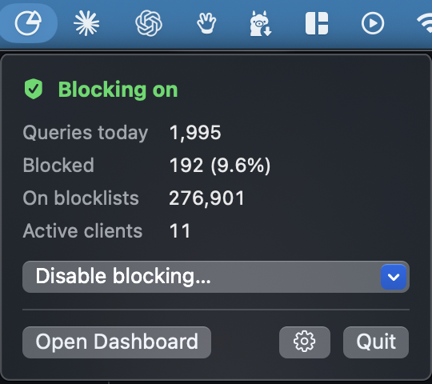
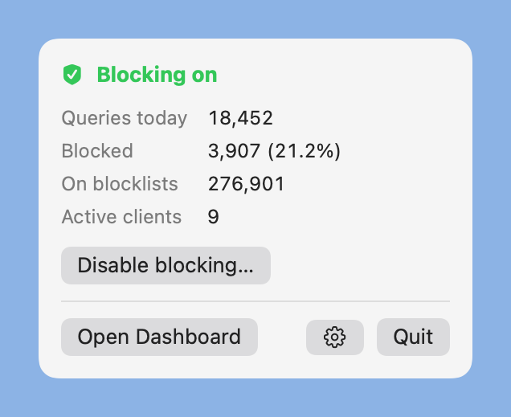
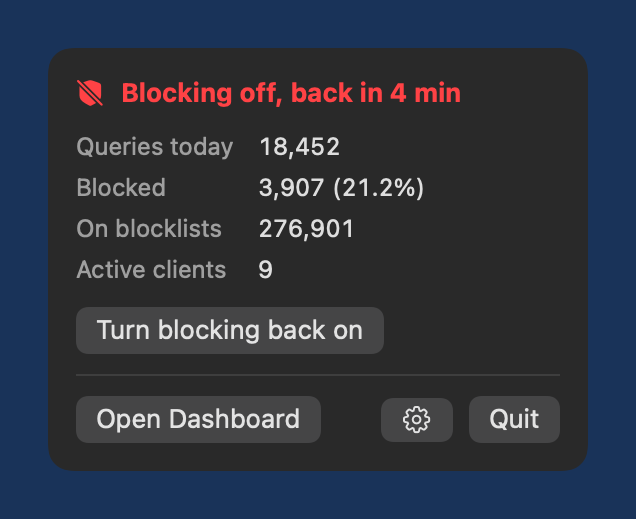
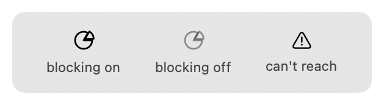
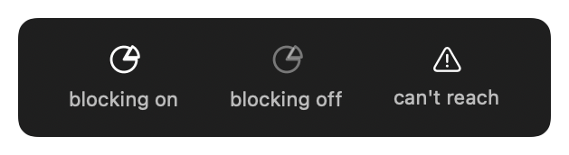

# PiHoleBar

A tiny macOS menu bar app for [Pi-hole](https://pi-hole.net) v6. See at a glance whether blocking is on, view today's stats, pause blocking for a few minutes, and jump to the dashboard.

- A little outline pie (Pi, get it) in the menu bar: solid = blocking on, faded = blocking off, warning triangle = can't reach Pi-hole.
- Click it for queries today, blocked count and percent, blocklist size, and active clients.
- **Disable blocking…** for 5 min, 30 min, or until you turn it back on.
- **Open Dashboard** opens `http://<your-pi>/admin`.
- Refreshes every 10 seconds. The admin password is kept in your macOS Keychain.

<p align="center">

</p>

<p>


</p>
<p>


</p>

Requires macOS 13+ and Pi-hole **v6** (it uses the v6 REST API).

## Install

```bash
brew install --cask Griff2325/tap/pihole-bar
```

Or download `PiHoleBar-1.0.0.zip` from [Releases](https://github.com/Griff2325/pihole-menubar/releases), unzip, and right-click `PiHoleBar.app` > **Open** the first time (the app is not notarized).

## Build and run

Needs Xcode or the command line tools (`xcode-select --install`).

```bash
git clone https://github.com/Griff2325/pihole-menubar.git
cd pihole-menubar
./build.sh
open PiHoleBar.app
```

Click the shield, enter your Pi-hole address (for example `pihole.local` or `192.168.1.2`) and admin password, then Save. macOS will ask to allow access to the local network the first time: click **Allow**.

To start it at login, drag `PiHoleBar.app` to Applications, then add it under System Settings > General > Login Items.

## Notes

- The screenshots are rendered with sample numbers: `PiHoleBar.app/Contents/MacOS/PiHoleBar --screenshots docs`.
- The app is ad-hoc signed, so it runs on the Mac that built it. To share a build, sign and notarize it with your own Apple developer ID.
- It talks to Pi-hole over plain HTTP on your local network. Use an address you trust.
- Pi-hole API sessions count against a small limit; the app reuses one session and re-logs in when it expires.

MIT licensed.

## For AI agents and automation

- What it is: a SwiftUI `MenuBarExtra` app (macOS 13+, Swift 5.9, no dependencies) for Pi-hole v6.
- Install: `brew install --cask Griff2325/tap/pihole-bar`. Build from source: `./build.sh`, output `PiHoleBar.app`.
- Config: address in `UserDefaults` (`host`), admin password in Keychain (service `PiHoleBar`).
- API used: `POST /api/auth`, `GET /api/stats/summary`, `GET` and `POST /api/dns/blocking` (header `sid`).
- Code map and conventions: see [AGENTS.md](AGENTS.md).
